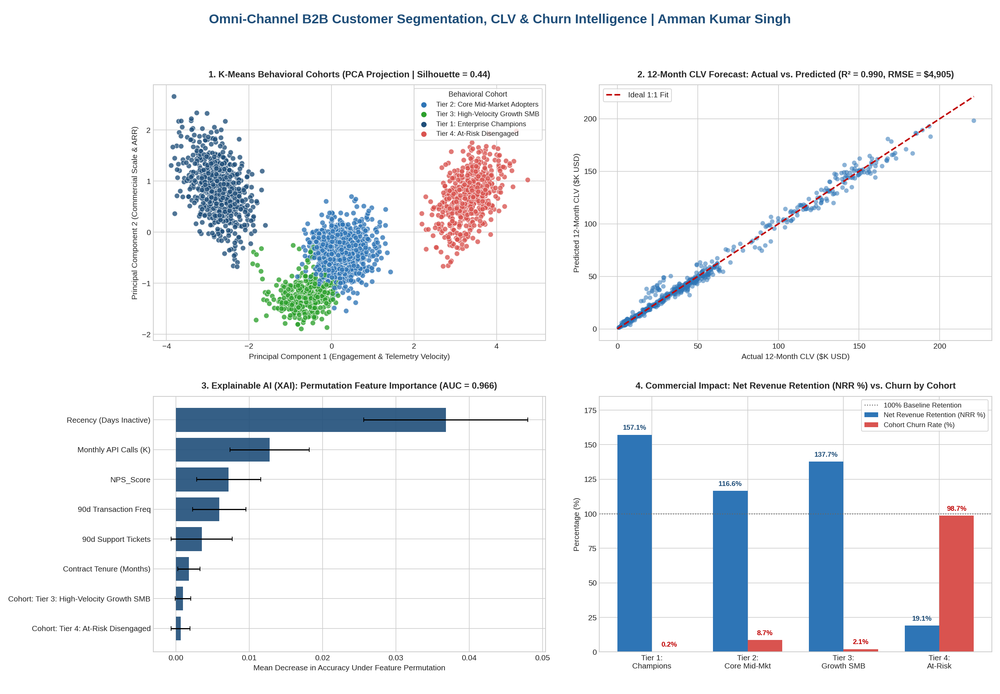

# 🚀 Omni-Channel B2B Customer Segmentation, CLV Forecasting & Churn Intelligence

**Author:** Amman Kumar Singh  
**LinkedIn:** [linkedin.com/in/amman-s-3a9301242](https://www.linkedin.com/in/amman-s-3a9301242)  
**Tech Stack:** Python (`Scikit-Learn`, `Pandas`, `NumPy`, `Matplotlib`, `Seaborn`), Unsupervised Learning (`K-Means`, `PCA`), Ensemble ML (`Gradient Boosting`, `Random Forest`), Explainable AI (`Permutation Importance`), Interactive HTML/JS Simulator

---

## 📌 Executive Summary & Business Problem
Modern B2B SaaS and digital product organizations cannot rely on single-metric churn models. Decision-makers need a unified **Customer Intelligence Engine** that answers three interconnected strategic questions:
1. **Who are our customer personas?** *(Unsupervised Behavioral Segmentation)*
2. **Which accounts are at risk of churning, and why?** *(Supervised Classification + Explainable AI)*
3. **How much net expansion revenue (CLV) will each account generate over the next 12 months?** *(Supervised Regression Forecasting)*

This project analyzes **2,500 B2B accounts** ($107.1M total ARR across APAC, EMEA, and North America), combining RFM metrics with product telemetry (`Monthly_API_Calls_K`, `GenAI_Copilot_Adoption_Rate`, `Seat_License_Utilization`) to automate commercial retention and expansion playbooks.

---

## 🏗️ Multi-Stage Machine Learning Architecture & Performance

| Pipeline Stage | Algorithm / Methodology | Target / Objective | Key Performance Metric |
| :--- | :--- | :--- | :--- |
| **1. Behavioral Segmentation** | `K-Means Clustering` + `2D PCA` | Discover natural RFM & telemetry cohorts | **Silhouette Score: 0.439** (4 Distinct Tiers) |
| **2. Churn Risk Prediction** | `Gradient Boosting Classifier` | Predict renewal attrition probability | **ROC-AUC: 0.967** \| **Accuracy: 94.7%** |
| **3. 12-Month CLV Forecast** | `Random Forest Regressor` | Forecast next-12M account revenue & NRR | **$R^2$: 0.990** \| **RMSE: $4,905** |
| **4. Explainable AI (XAI)** | `Permutation Feature Importance` | Isolate root-cause drivers of account churn | Top Driver: **Recency & Low GenAI Adoption** |

---

## 📊 Executive Visual Analytics Suite

---

## 🧩 Cohort Discovery & Strategic Playbooks

| Behavioral Cohort | Accounts | Mean Current ARR | Forecasted 12M CLV | GenAI Copilot Adoption | Observed Churn Rate | Strategic Product & KAM Action |
| :--- | :---: | :---: | :---: | :---: | :---: | :--- |
| **Tier 1: Enterprise Champions** | 619 | $85,349 | $133,890 (+56.9% NRR) | 84.1% | **0.2%** | Target for multi-year contract lock-in & enterprise API tier upsell |
| **Tier 2: Core Mid-Market Adopters** | 912 | $35,613 | $43,540 (+22.3% NRR) | 51.8% | **9.6%** | Drive GenAI Copilot adoption above 65% to transition into Tier 1 |
| **Tier 3: High-Velocity Growth SMB** | 436 | $13,858 | $19,785 (+42.8% NRR) | 68.3% | **1.6%** | Automate self-serve seat expansion prompts at 80% license utilization |
| **Tier 4: At-Risk Disengaged** | 533 | $27,729 | $12,065 (-56.5% NRR) | 18.0% | **97.4%** | Trigger automated 90-day renewal rescue & executive sponsor escalation |

---

## 📂 Repository Structure
* `OmniChannel_Segmentation_CLV_Intelligence.ipynb` — End-to-end Jupyter Notebook executing K-Means clustering, PCA dimensionality reduction, Gradient Boosting classification, Random Forest regression, and XAI feature importance.
* `omnichannel_customer_intelligence_data.csv` — Multi-dimensional dataset of 2,500 B2B accounts across 15 behavioral, telemetry, and revenue attributes.
* `Executive_CLV_Simulator_Dashboard.html` — Interactive web application & scenario simulator for Key Account Managers to test real-time CLV and churn sensitivity.
* `omnichannel_clv_analytics_suite.png` — 4-panel high-resolution executive dashboard visualization.
* `README.md` — Project documentation and strategic business recommendations.
